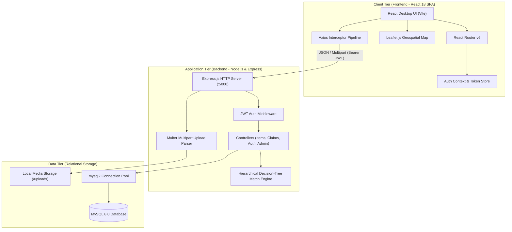
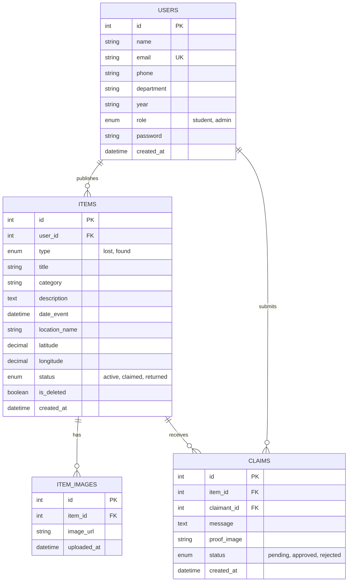
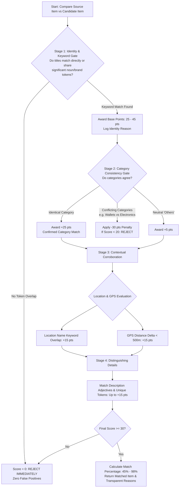
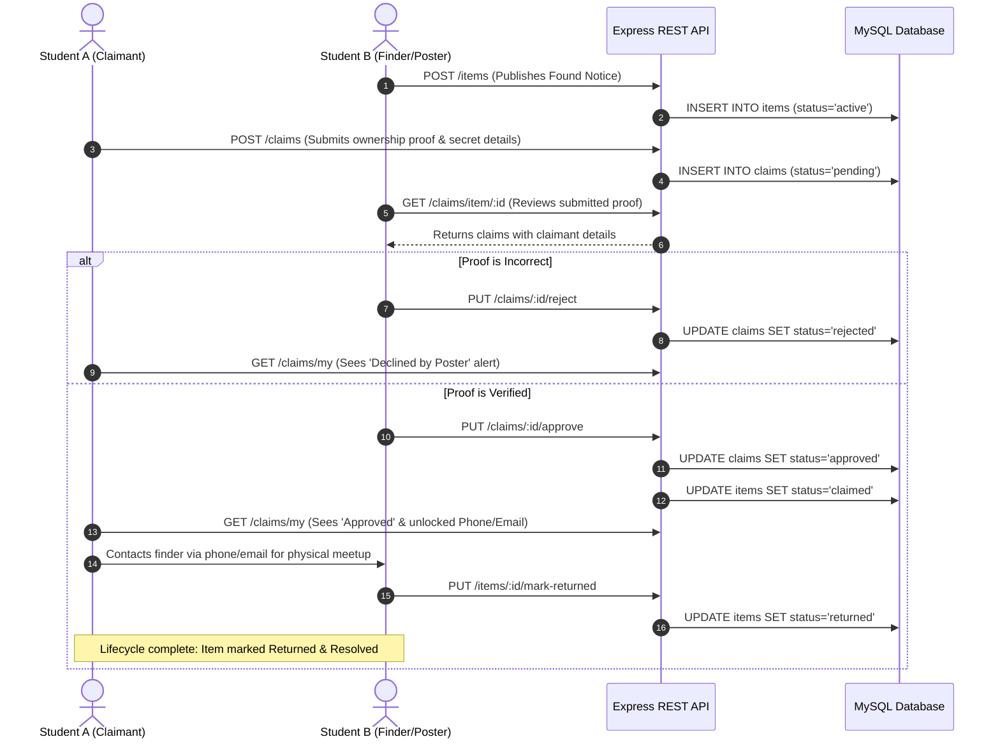

# Campus Recovery – Smart Lost & Found Web Portal
## Complete Engineering, Architecture, and Functional Specifications Document

---

## 1. Executive Summary & Overview

**Campus Recovery** is an intelligent, full-stack lost-and-found management portal designed for university campuses and academic institutions. Conventional lost-and-found systems in academic settings are fragmented, manual, and unreliable—typically relying on unstructured messaging groups (WhatsApp/Telegram), bulletin boards, or uncatalogued campus security bins. 

This platform modernizes the entire lifecycle of campus asset recovery through:
1. **Hierarchical Decision-Tree Cross-Matching:** Automatically connects opposite "Lost" and "Found" reports in real-time, eliminating manual cross-referencing.
2. **Multi-Tier Campus Geolocation:** Pairs interactive geospatial mapping (Leaflet.js) with device GPS, network IP fallback, and campus landmark presets.
3. **Closed-Loop Verification & Lifecycle Tracking:** Privacy-preserving ownership claim workflows that prevent false claims and track items from report to verified physical return.
4. **Role-Based Access Control (RBAC):** Distinct interfaces and capabilities for Campus Members (Students/Faculty) and System Administrators.

---

## 2. Problem Statement & Motivation

### 2.1 Existing Gaps in Conventional Campus Systems
* **Information Fragmentation:** Lost notices are dispersed across informal social media chats, physical bulletin boards, and security offices.
* **Absence of Intelligent Counterpart Detection:** If Student A reports a lost *Dell XPS* and Student B reports finding a *Dell Laptop*, neither party is automatically alerted. Both records remain isolated.
* **Privacy & Security Risks:** Publicly sharing student phone numbers and photos of found valuables leads to spam, false claims, and extortion.
* **Lack of Accountability & Resolution:** Conventional notices rarely get marked as resolved, resulting in outdated lists and duplicate efforts.

### 2.2 System Objectives
* Provide a single, authoritative university directory for lost and found belongings.
* Prevent duplicate reporting via a proactive **Live Matchmaker Radar**.
* Secure personal contact information by revealing finder contact details **only after ownership verification** is approved.
* Implement a transparent 4-stage lifecycle tracker (`Reported` $\rightarrow$ `Under Review` $\rightarrow$ `Verified / Contact Shared` $\rightarrow$ `Handed Over & Returned`).

---

## 3. System Architecture

The application adopts a decoupled **3-Tier Client-Server Architecture**:



### 3.1 Technology Stack Details

| Layer | Technology | Version | Purpose |
| :--- | :--- | :--- | :--- |
| **Frontend Core** | React | 18.3+ | Component-driven Single Page Application |
| **Build Tooling** | Vite | 8.3+ | Hot Module Replacement (HMR) & ESBuild bundling |
| **Routing** | React Router DOM | 6.x | Client-side routing with role-based navigation guards |
| **Geospatial UI** | Leaflet.js & CARTO Positron | 1.9+ | Interactive campus map, custom SVG status pins |
| **Styling** | Vanilla CSS Design System | CSS3 | Custom tokens, CSS variables, zero runtime overhead |
| **Backend Runtime** | Node.js | v20+ / v24+ | Asynchronous event-driven server runtime |
| **Web Framework** | Express.js | 4.x | RESTful API routing, middleware chaining |
| **Authentication** | JSON Web Tokens (`jsonwebtoken`) | 9.x | Stateless Bearer token authorization (7-day validity) |
| **Password Hashing**| `bcryptjs` | 2.4+ | Salted password hashing (10 salt rounds) |
| **File Uploads** | `multer` | 1.4+ | Multipart file validation, size constraints, storage |
| **Database** | MySQL | 8.0+ | ACID-compliant relational data management |
| **DB Driver** | `mysql2/promise` | 3.x | Non-blocking asynchronous connection pooling |

---

## 4. Relational Database Design (Data Dictionary)

The database schema enforces data integrity through foreign keys, enumerations, and automated timestamps.



### 4.1 Schema Tables Specification

#### 1. `users` Table
Stores registered students, staff, and administrators.
* `id` (`INT`, PK, Auto-Increment): Unique identifier.
* `name` (`VARCHAR(100)`, NOT NULL): Full legal campus name.
* `email` (`VARCHAR(150)`, UNIQUE, NOT NULL): Campus email address.
* `phone` (`VARCHAR(20)`): 10-digit primary mobile contact number.
* `department` (`VARCHAR(100)`): Academic branch/department.
* `year` (`VARCHAR(20)`): Academic year of study.
* `role` (`ENUM('student', 'admin')`, Default `'student'`): Access role.
* `password` (`VARCHAR(255)`, NOT NULL): Salted bcrypt password hash.
* `created_at` (`TIMESTAMP`, Default `CURRENT_TIMESTAMP`).

#### 2. `items` Table
Stores published notices for lost or found items.
* `id` (`INT`, PK, Auto-Increment): Unique item identifier.
* `user_id` (`INT`, FK $\rightarrow$ `users.id`): Identifier of the poster.
* `type` (`ENUM('lost', 'found')`, NOT NULL): Notice classification.
* `title` (`VARCHAR(200)`, NOT NULL): Clear item descriptor.
* `category` (`VARCHAR(50)`, NOT NULL): Taxonomy (`electronics`, `keys`, `wallets`, `id_cards`, `bags`, `valuables`, `others`).
* `description` (`TEXT`, NOT NULL): Distinguishing marks, colors, serial numbers, context.
* `date_event` (`DATETIME`): Date and time the item was lost or found.
* `location_name` (`VARCHAR(255)`, NOT NULL): Campus building, room, or landmark.
* `latitude` (`DECIMAL(10, 8)`): Geospatial latitude coordinate.
* `longitude` (`DECIMAL(11, 8)`): Geospatial longitude coordinate.
* `status` (`ENUM('active', 'claimed', 'returned')`, Default `'active'`): Current lifecycle state.
* `is_deleted` (`BOOLEAN`, Default `FALSE`): Soft deletion flag for audits.
* `created_at` (`TIMESTAMP`, Default `CURRENT_TIMESTAMP`).

#### 3. `item_images` Table
Stores reference photographs uploaded by owners reporting a loss.
* `id` (`INT`, PK, Auto-Increment).
* `item_id` (`INT`, FK $\rightarrow$ `items.id`, ON DELETE CASCADE).
* `image_url` (`VARCHAR(255)`): Stored path relative to server root.
* `uploaded_at` (`TIMESTAMP`, Default `CURRENT_TIMESTAMP`).

#### 4. `claims` Table
Stores verification claims submitted by claimants proving ownership.
* `id` (`INT`, PK, Auto-Increment).
* `item_id` (`INT`, FK $\rightarrow$ `items.id`, ON DELETE CASCADE).
* `claimant_id` (`INT`, FK $\rightarrow$ `users.id`): Student claiming ownership.
* `message` (`TEXT`, NOT NULL): Detailed verification evidence (e.g., wallpaper description, internal pouch contents, unique scratch locations).
* `proof_image` (`VARCHAR(255)`): Supporting evidence photo (e.g., purchase invoice, matching key set).
* `status` (`ENUM('pending', 'approved', 'rejected')`, Default `'pending'`).
* `created_at` (`TIMESTAMP`, Default `CURRENT_TIMESTAMP`).

---

## 5. Core Features & Functional Specifications

### 5.1 Authentication & Session Management
* **Registration Validation:** Validates genuine email format and enforces 10-digit numeric phone format to guarantee legitimate contact during handovers.
* **Token Validity:** Generates standard Bearer JWT tokens valid for **7 days** to ensure smooth persistence during development and campus operations.
* **Context Persistence:** Frontend `AuthContext` syncs current user data (`name`, `email`, `role`, `id`) via `GET /me` upon every application mount.

### 5.2 Dynamic Notice Publishing (`SubmitItem.jsx`)
* **Lost vs. Found Security Rule:**
  * **Lost Items:** Users are encouraged to upload reference images to assist finders in identifying the item.
  * **Found Items:** Images are **strictly disallowed by default** on public feeds. This prevents dishonest claimants from using visual cues to construct fabricated ownership proof. Claimants must independently describe the found item.
* **Multi-Tier Geolocation System:**
  1. *Tier 1 (Browser Geolocation API):* Fast 3.5s timeout with relaxed accuracy requirements suitable for desktop PCs.
  2. *Tier 2 (IP-based Network Cascade):* Queries external IP geolocation endpoints (`ipwho.is`, `freeipapi.com`) if device hardware GPS is blocked.
  3. *Tier 3 (Campus Central Hub Preset):* Automatically attaches default Central Library coordinates (`8.548446, 76.938576`) if network access is restricted.
  4. *1-Click Campus Landmark Presets:* Immediate buttons for high-traffic zones:
     * Central Library (`8.548446, 76.938576`)
     * Main Canteen (`8.549100, 76.939200`)
     * CS & Tech Labs (`8.547800, 76.937900`)
     * Block B Halls (`8.548900, 76.937500`)
     * Sports Complex (`8.550200, 76.939800`)
     * Security Helpdesk (`8.547200, 76.938900`)

---

### 5.3 Hierarchical Decision-Tree Cross-Match Engine

The platform avoids flat additive scoring (which could produce false positives such as matching an *umbrella* with a *water bottle* simply because both are tagged as *"others"* in the *"Library"*). Instead, it implements a **strict 4-stage hierarchical decision tree**:



#### Match Scoring Formula
$$\text{Raw Score} = S_{\text{identity}} + S_{\text{category}} + S_{\text{location}} + S_{\text{gps}} + S_{\text{attributes}}$$
$$\text{Match Percentage} = \min\left(98\%, \max\left(45\%, \text{round}\left(\frac{\text{Raw Score}}{100} \times 100\right)\right)\right)$$

---

### 5.4 Closed-Loop Claim Verification & Handover Lifecycle



---

## 6. REST API Endpoints Specification

All authenticated endpoints require an `Authorization: Bearer <JWT>` HTTP header.

### 6.1 Authentication Routes (`/`)
| Method | Endpoint | Auth | Request Body | Description |
| :--- | :--- | :--- | :--- | :--- |
| `GET` | `/check-email` | No | `?email=...` | Checks email availability during registration. |
| `POST` | `/register` | No | `{ name, email, phone, department, year, password }` | Registers a new student account. |
| `POST` | `/login` | No | `{ email, password }` | Validates credentials and returns a 7-day JWT. |
| `GET` | `/me` | Yes | *None* | Returns authenticated user's profile details. |

### 6.2 Item Directory Routes (`/items`)
| Method | Endpoint | Auth | Request Body | Description |
| :--- | :--- | :--- | :--- | :--- |
| `GET` | `/items` | No | Query: `type`, `status`, `category`, `search` | Paginated feed of public items. |
| `POST` | `/items` | Yes | Multipart FormData (`title`, `category`, `location_name`, `latitude`, `longitude`, `image`) | Publishes a new lost/found notice. |
| `GET` | `/items/my` | Yes | *None* | Retrieves all notices posted by the current user. |
| `GET` | `/items/:item_id` | No | *None* | Retrieves complete details for a single notice. |
| `GET` | `/items/potential-matches` | No | Query: `type`, `category`, `title`, `location_name` | Real-time Live Radar match suggestions for forms. |
| `GET` | `/items/:item_id/matches` | No | *None* | Deep counterpart analysis for a published item. |
| `PUT` | `/items/:item_id/mark-returned`| Yes | *None* | Marks item status as `returned` (Owner only). |

### 6.3 Claim Management Routes (`/claims`)
| Method | Endpoint | Auth | Request Body | Description |
| :--- | :--- | :--- | :--- | :--- |
| `POST` | `/claims` | Yes | Multipart: `item_id`, `message`, `proof_image` | Submits an ownership claim with evidence. |
| `GET` | `/claims/my` | Yes | *None* | Returns all claims submitted by the current user. |
| `GET` | `/claims/item/:item_id` | Yes | *None* | Returns all claims submitted for user's item. |
| `PUT` | `/claims/:claim_id/approve` | Yes | *None* | Approves claim and transitions item to `claimed`. |
| `PUT` | `/claims/:claim_id/reject` | Yes | *None* | Rejects invalid claim. |

### 6.4 Administrative Governance Routes (`/admin`)
| Method | Endpoint | Auth (Admin) | Description |
| :--- | :--- | :--- | :--- |
| `GET` | `/admin/stats` | Yes | System metrics (total users, active items, recovered items). |
| `GET` | `/admin/users` | Yes | User directory for identity audit. |
| `GET` | `/admin/items` | Yes | Moderation feed across all posted notices. |
| `DELETE`| `/admin/items/:item_id`| Yes | Soft deletes fraudulent or inappropriate notices. |
| `GET` | `/admin/claims` | Yes | Global audit of claims across the university. |

---

## 7. UI/UX Design System Specification

The user interface uses the **Sage & Slate Botanical** theme:
* **Background Canvas:** `#f4f7f5` (Muted Sage)
* **Primary Deep Pine:** `#1b382f` (Navigation, high-contrast headings)
* **Accent Eucalyptus:** `#107e5b` (Primary buttons, verified badges, active states)
* **Terracotta / Coral Alert:** `#c25450` (Lost item badges, decline alerts)
* **Neutral Slate:** `#334155` / `#64748b` (Readable body text and secondary metadata)
* **Interactive Map Tiles:** CartoDB Positron / OpenStreetMap (high-contrast, light clean theme).

---

## 8. Alignment with UN Sustainable Development Goals (SDGs)

1. **SDG 11: Sustainable Cities and Communities (Target 11.7):**
   * Creates safe, organized, and cooperative campus environments through modern communal asset recovery.
2. **SDG 12: Responsible Consumption and Production (Target 12.5):**
   * Substantially reduces material waste on campus by ensuring lost calculators, textbooks, electronics, and accessories are reunited with their owners rather than discarded.
3. **SDG 9: Industry, Innovation, and Infrastructure (Target 9.c):**
   * Upgrades traditional campus operations with automated decision-tree algorithms and modern web engineering.

---

## 9. Project Installation & Local Execution Guide

### 9.1 Prerequisites
* **Node.js:** v18.0.0 or higher
* **MySQL Server:** v8.0 or higher

### 9.2 Backend Setup
```bash
cd backend-express
npm install

# Configure environment variables in backend-express/.env
# DB_HOST=localhost
# DB_USER=root
# DB_PASSWORD=your_password
# DB_NAME=lost_found_db
# JWT_SECRET=super_secret_jwt_key_lost_and_found_2026
# PORT=5000

npm run dev
# Server boots on http://localhost:5000
```

### 9.3 Frontend Setup
```bash
cd frontend
npm install
npm run dev
# Client boots on http://localhost:5173
```

---

## 10. Future Roadmap

1. **Computer Vision Visual Comparison:** Integrate Python/FastAPI microservices running **YOLOv8** and feature embeddings (ResNet-50) for optical item similarity.
2. **RFID / NFC Campus Card Integration:** Allow tap-to-claim for university student ID cards.
3. **Automated Notification Gateway:** Instant WhatsApp / Telegram bot alerts when high-confidence counterparts are detected.
